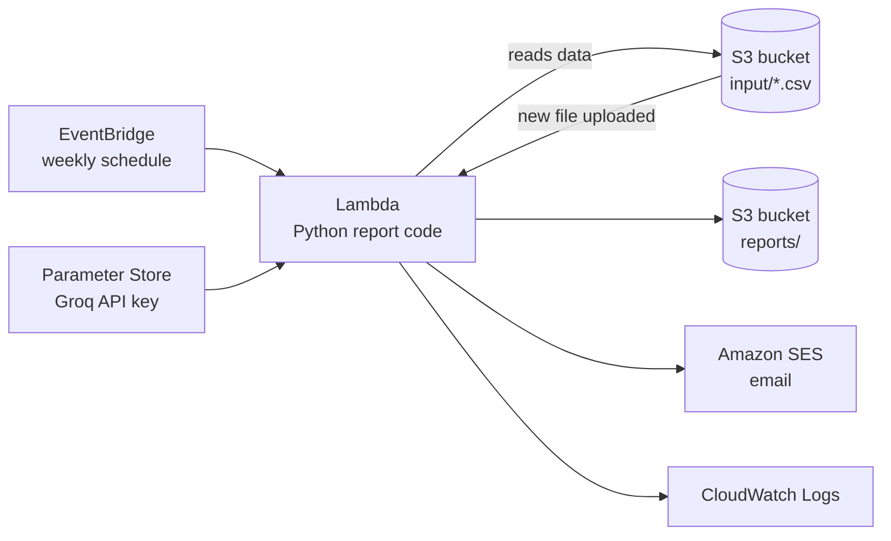

# Weekly Sales Report Automation

A Python tool that turns a raw sales CSV into a clear weekly report: revenue, orders, average order value, top products, and a plain-English summary of how this week compared to last week. It runs locally, and it is also deployed to AWS with Terraform, where it builds the report and emails it automatically every Monday and whenever a new sales file is uploaded.

Small businesses often spend hours every week copying numbers into reports. This automates that.

The summary can be written by an AI (Groq's free API). If the AI is unavailable, the tool falls back to a rule-based summary automatically, so the report always gets produced.

## Sample output

```
WEEKLY SALES REPORT
Week: 2026-10-20 to 2026-10-26
========================================

Revenue:         $3,731.50  (+68.4% vs last week)
Orders:          88  (+57.1% vs last week)
Avg order value: $42.40  (+7.2% vs last week)

Top products by revenue:
  1. Pour-Over Kit: $1,482.00
  2. Espresso Beans 1kg: $1,008.00
  3. Gift Card: $675.00

Summary:
Revenue was $3,731.50, up strongly (+68.4%) vs last week. The biggest factor was
order volume (+57.1%). Pour-Over Kit was the top seller with $1,482.00 (40% of
revenue). Last week's top seller was Gift Card.
```

(The data in this repo is generated sample data for a fictional coffee shop.)

## Architecture (AWS)



The Lambda function starts in two ways: every Monday on a schedule, and whenever a new `.csv` file is uploaded to the `input/` folder. It reads the sales data from S3, builds the report, saves it to `reports/` (a different folder, so it can never trigger itself), and emails it with Amazon SES. All of the infrastructure is defined as code in the `terraform/` folder.

**Security choices**
- The S3 bucket blocks all public access and is encrypted at rest.
- The Lambda's IAM role follows least privilege: it can read `input/*`, write `reports/*`, read exactly one Parameter Store value, and send email only for the two verified addresses, and nothing else.
- Email addresses are Terraform variables kept in a `terraform.tfvars` file that is excluded from Git.
- The Groq API key is stored as an encrypted SecureString in AWS Systems Manager Parameter Store. It is created by hand, so it never appears in the code, in Git, or in Terraform's state file.
- Terraform state files and variable files are excluded from Git.

## Features

- Reads sales data from a CSV file
- Compares the latest 7 days against the 7 days before
- Calculates revenue, order count, average order value, and top products
- AI-written summary through the Groq API, told to use only the supplied facts so it does not invent explanations
- Automatic fallback to a rule-based summary if the API key, package, or network is unavailable
- Handles edge cases such as no data for the previous week (no divide-by-zero crashes) and an empty file
- Deployed on AWS (S3, Lambda, EventBridge) with Terraform
- Runs on a weekly schedule and also automatically when a new CSV is uploaded
- Emails the finished report through Amazon SES; if the email fails, the report is still saved

## Project structure

| File | Purpose |
|---|---|
| `make_sample_data.py` | Generates fake sales data (`sales.csv`) |
| `report.py` | Loads data, splits weeks, calculates the numbers, builds the report |
| `summary.py` | Rule-based summary writer (no AI, no key needed) |
| `ai_summary.py` | AI summary via Groq, with fallback to `summary.py` |
| `report_v2.py` | Runs everything locally and saves `weekly_report_v2.txt` |
| `lambda_function.py` | AWS Lambda entry point: S3 in, report out |
| `terraform/` | Infrastructure as code: S3 bucket, IAM, Lambda, schedule, upload trigger, SES, logs |
| `terraform/build.sh` | Packages the code and the `groq` library for Lambda's Linux platform |

The summarizer is a swappable function. Changing one line in `report_v2.py` switches between AI and rule-based summaries.

## Run it locally

Requires Python 3.9 or newer.

```bash
git clone https://github.com/gabrielatwater/weekly-sales-report.git
cd weekly-sales-report
python3 -m venv .venv
source .venv/bin/activate
pip install groq
```

Optional, for the AI summary: get a free API key at [console.groq.com/keys](https://console.groq.com/keys), then:

```bash
export GROQ_API_KEY="your-key-here"
```

```bash
python3 make_sample_data.py   # optional: create fresh sample data
python3 report_v2.py          # generate the report
```

No API key? The report still runs and uses the rule-based summary.

## Deploy to AWS

Requires an AWS account, the AWS CLI configured with credentials, and Terraform 1.5 or newer.

Optional, for the AI summary: store your Groq key in Parameter Store first. This prompt hides what you type and keeps the key out of your shell history:

```bash
read -s -p "Groq key: " KEY; echo
aws ssm put-parameter --name "/weekly-sales-report/groq-api-key" --type SecureString --value "$KEY" --overwrite
unset KEY
```

Without the key, the Lambda still works and uses the rule-based summary.

Choose where the report is emailed. Create `terraform/terraform.tfvars` (it is ignored by Git). The same address can be used for both:

```hcl
sender_email    = "you@example.com"
recipient_email = "you@example.com"
```

After `terraform apply`, AWS sends a verification link to each address. Click it, because SES will not send from or to unverified addresses. New AWS accounts start in the SES sandbox, which only allows verified recipients.

Then build the Lambda package (our code plus the `groq` library, built for Lambda's Linux platform) and deploy:

```bash
cd terraform
bash build.sh       # must run before plan/apply
terraform init
terraform plan      # review what will be created
terraform apply
```

Run the report immediately instead of waiting for Monday, then read it:

```bash
aws lambda invoke --function-name weekly-sales-report-lambda \
  --cli-binary-format raw-in-base64-out /tmp/out.json
aws s3 cp s3://$(terraform output -raw bucket_name)/reports/ /tmp/reports --recursive
cat /tmp/reports/*
```

Remove everything when you are done (the Parameter Store key is not managed by Terraform, so delete it separately):

```bash
terraform destroy
aws ssm delete-parameter --name "/weekly-sales-report/groq-api-key"
```

The workload is one tiny function run per week, so it is designed to cost very little. Check current AWS pricing and set a billing alert before you deploy.

## Roadmap

- [x] Version 1: report from a CSV
- [x] Version 2: AI-written summary with automatic fallback
- [x] Version 3: runs weekly on AWS (S3, Lambda, EventBridge), defined with Terraform
- [x] Version 3b: AI summary in the cloud, with the API key stored in AWS Systems Manager Parameter Store
- [x] Version 4: email the report with Amazon SES, and run automatically when a new CSV is uploaded
- [ ] Version 5: read from a live data source such as a Google Sheet
- [ ] Request SES production access so reports can go to unverified addresses

## What I learned

Working with CSV data and dictionaries in Python, structuring code into small reusable functions, calling an AI API and writing prompts that limit it to supplied facts, building in fallbacks so automation fails gracefully, and deploying serverless infrastructure on AWS with Terraform using least-privilege IAM.

## Author

Gabriel Atwater
